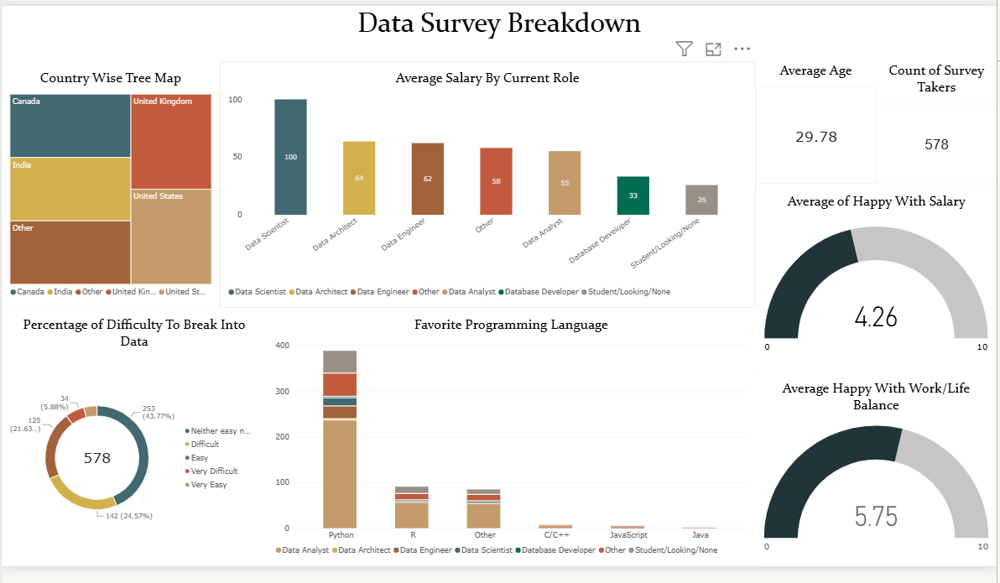

# Data Professional Survey Analysis — Power BI Dashboard


An interactive **Power BI dashboard for exploring a survey of data professionals**. The project examines respondents' job roles, locations, salary-related satisfaction, work-life balance, programming-language preferences, and perceptions of how difficult it is to enter the data industry.

The source data was imported from Excel and **wrangled in Power Query before the dashboard visualizations were developed**. The prepared data was then used to build the report in Power BI.

> **Project workflow:** Excel source data → Power Query data wrangling → Power BI data model → Dashboard visualizations → Insight generation.

---

## Contents

- [Project Objectives](#project-objectives)
- [Tools and Technologies](#tools-and-technologies)
- [Dashboard Preview](#dashboard-preview)
- [Dashboard Features](#dashboard-features)
- [Selected Findings](#selected-findings)
- [Data Preparation Workflow](#data-preparation-workflow)
- [Repository Structure](#repository-structure)
- [How to Open the Project](#how-to-open-the-project)
- [Data Notes and Limitations](#data-notes-and-limitations)
- [Learning Outcomes](#learning-outcomes)
- [Future Improvements](#future-improvements)

---

## Project Objectives

The goal of this project is to turn survey responses into an accessible visual summary of the data-professional landscape.

The dashboard is designed to:

- Explore the countries represented in the survey.
- Compare respondents across current professional roles.
- Review the salary metric by current role.
- Examine respondents' average age.
- Understand salary and work-life balance satisfaction.
- Explore how respondents describe the difficulty of entering the data field.
- Compare favourite programming-language responses across professional roles.

## Tools and Technologies

| Tool | Purpose |
|---|---|
| Microsoft Power BI Desktop | Data model, report development and visualizations |
| Power Query | Data inspection, wrangling and transformation before visualization |
| Microsoft Excel | Original survey dataset |

DAX can be documented here if measures were created using DAX. Only list techniques that were actually used in the project.

---

## Dashboard Preview



The dashboard combines KPI cards, a treemap, column charts, a doughnut chart and gauge visuals to present multiple aspects of the survey in one report.

---

## Dashboard Features

| Visual | What it presents |
|---|---|
| Country Wise Tree Map | Distribution of survey respondents by country |
| Average Salary by Current Role | Salary-related comparison across current roles, as configured in the report |
| Average Age | Average age displayed for the report's current filter context |
| Count of Survey Takers | Number of survey takers represented in the report |
| Average of Happy With Salary | Average salary-satisfaction rating |
| Average Happy With Work/Life Balance | Average work-life-balance satisfaction |
| Percentage of Difficulty To Break Into Data | Distribution of responses about entering the data industry |
| Favorite Programming Language | Programming-language preferences segmented by current role |

### Dashboard Values

The following values are displayed in the supplied dashboard screenshot:

| KPI | Displayed Value |
|---|---:|
| Average Age | 29.78 |
| Survey Takers | 578 |
| Average Salary Satisfaction | 4.26 / 10 |
| Average Work-Life Balance Satisfaction | 5.75 / 10 |

These values may change if filters, data, or measures are modified.

---

## Selected Findings

The following observations are based on the supplied Excel workbook's 630 data rows. The dashboard screenshot displays 578 survey takers, so workbook-level counts and report-level figures have different denominators and should not be mixed.

- **Current Role:** Data Analyst is the largest role category in the workbook, with 381 responses.
- **Programming Language:** Python is the most frequently selected named programming-language response, with 420 responses.
- **Career Entry:** 200 respondents selected either Difficult or Very Difficult when asked about breaking into data.
- **Geography:** The United States has the largest country count in the workbook, with 261 responses, followed by India with 73.
- **Satisfaction:** The dashboard shows a higher average rating for work-life balance (5.75) than for salary satisfaction (4.26).

These are descriptive findings from this survey dataset, not estimates of the entire global data workforce.

---

## Data Preparation Workflow

The dataset was imported from Excel into Power BI. Before creating the report visuals, the data was **wrangled using Power Query in Power BI**.

The overall workflow was:

1. Import the Excel workbook into Power BI.
2. Inspect the source columns and survey responses in Power Query.
3. Perform the required data-wrangling and preparation in Power Query.
4. Load the prepared data into the Power BI data model.
5. Build the dashboard visuals and KPI summaries.
6. Review the report to communicate patterns in the survey responses.

The exact transformation steps should be described by the operations actually performed in the Power Query Editor.

See [Project Documentation](Documentation/Project_Documentation.md) for the detailed workflow and interpretation notes.

---

## Repository Structure

```text
Data-Professional-Survey-Analysis/
│
├── Dashboard/
│   └── Power BI Project.pbix
│
├── Dataset/
│   └── Power BI - Final Project.xlsx
│
├── Documentation/
│   └── Project_Documentation.md
│
├── Screenshots/
│   ├── Dashboard.png
│   └── Wrangled_Data.png
│
└── README.md
```

---

## How to Open the Project

1. Clone or download this repository.
2. Install or open Microsoft Power BI Desktop.
3. Open `Dashboard/Power BI Project.pbix`.
4. If Power BI cannot locate the source workbook, update the file path in the query's data source settings to the copy in `Dataset/`.
5. Refresh the data if required.
6. Explore the report visuals and available filters.

---

## Data Notes and Limitations

- The supplied Excel workbook contains 630 response rows, while the dashboard screenshot displays 578 survey takers. This may reflect filtering, exclusions, or the report's calculation context. Confirm the reason in Power BI before describing the difference.
- The source workbook contains fields such as Email and Unique ID. **Do not publish identifiable respondent information.** Remove or anonymize those fields in the public copy of the dataset, or publish only a suitably anonymized dataset.
- Some survey answers are free-text categories and may have spelling, capitalization, or wording variations.
- Survey responses describe the people who participated; they should not be treated as a statistically representative sample of all data professionals.
- Salary is recorded in ranges in the source workbook. Do not describe a chart as an average salary in currency unless the report's calculation converts the salary bands appropriately and the method is documented.

---

## Learning Outcomes

This project provided practical experience with:

- Importing survey data from Excel into Power BI.
- Wrangling and preparing data with Power Query.
- Building a Power BI report using multiple visualization types.
- Presenting summary KPIs.
- Comparing categories and interpreting survey responses.
- Communicating findings through a consolidated dashboard.

---

## Future Improvements

- Document the exact Power Query transformations performed.
- Verify and document the calculation used in the salary-by-role visual.
- Explain the difference between the 630 workbook rows and 578 survey takers shown in the report.
- Add concise annotations to highlight important findings directly on the dashboard.
- Add report-level filters or slicers if they improve exploration.
- Publish an anonymized dataset and a short data dictionary.

---

## Author

**Mohammed Saqhibuddin Khan**

Information Science and Engineering Student | Aspiring Data Analyst

- GitHub: [mosaqhibkhan](https://github.com/mosaqhibkhan)
- LinkedIn: [Mohammed Saqhib Uddin Khan](https://www.linkedin.com/in/mohammed-saqhib-uddin-khan)